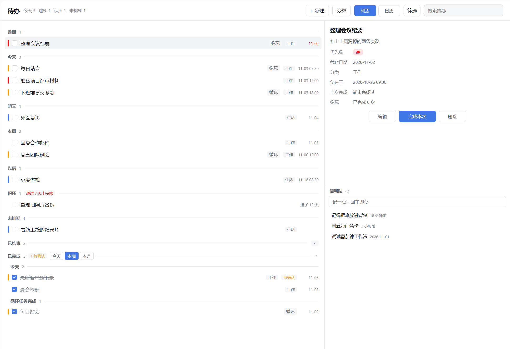
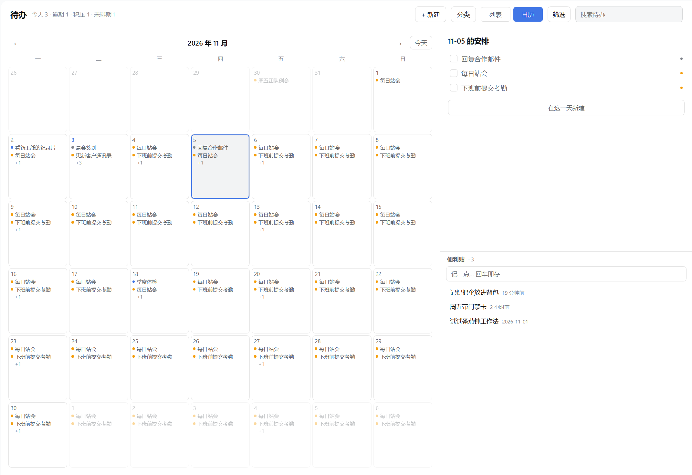
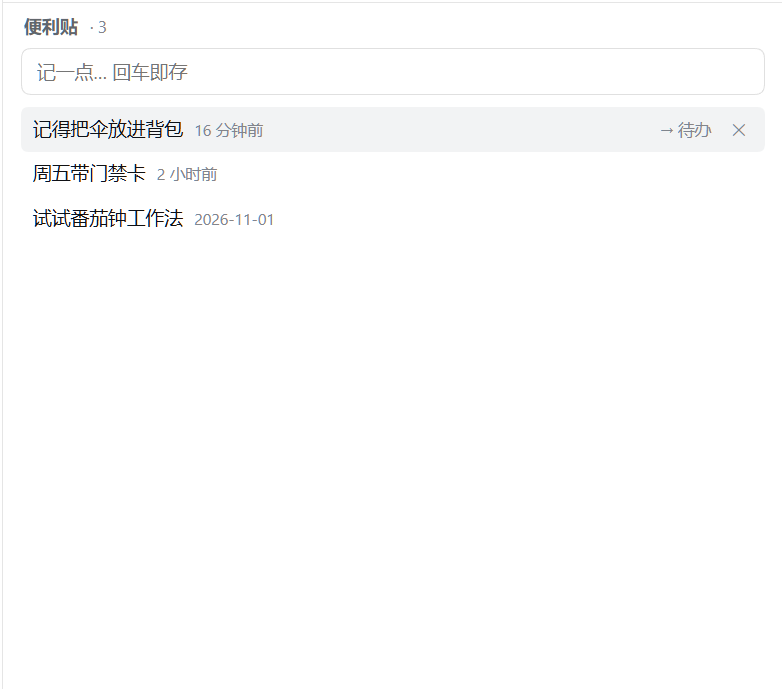
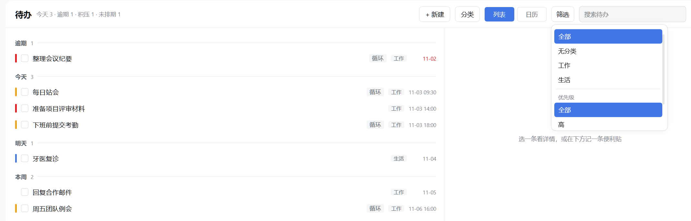

# dsh-sidebar-todo

DeepSeek Harness 的侧栏待办插件：清单、循环任务、月视图日历与便利贴，数据保存在本机一个 JSON 文件里，agent 通过工具读写同一份。

仓库、npm 包与插件标识统一为 `dsh-sidebar-todo`，侧栏显示的名字是「待办」。已发布：https://www.npmjs.com/package/dsh-sidebar-todo



当前版本 0.3.0，功能包含编辑弹窗、循环任务、月视图日历、分类，以及 0.3.0 新增的便签、筛选与已结束循环组。改动记录见 [CHANGELOG.md](CHANGELOG.md)。

## 安装

从 npm（推荐）：

```bash
dsh plugin --profile web add dsh-sidebar-todo
```

装完在侧栏「自动化任务」下方出现「待办」。也可以在宿主的「插件 → 发现」里搜 `dsh-sidebar-todo` 或「待办」，一键安装。

从 GitHub 源码（适合想跟最新提交、或 npm 还没发到新版本时；更新按 commit 追）：

```bash
dsh plugin --profile web add github:Natte/dsh-sidebar-todo
```

本机开发：把仓库目录直接装进 profile（链接方式，改代码即时生效）。

```text
plugin_manager install_bundle  target: D:\dsh-sidebar-todo
```

装了之后改 `index.js` 需要把插件行关再开才会重新加载模块；只改 `client.js` 会被 HMR 自动拾取。

## 数据文件

默认 `%DSH_PROFILE_DIR%/data/dsh-todolist/todos.json`：

```json
{
  "version": 1,
  "todos": [ { "id": "t_...", "title": "交周报", "dueDate": "2026-10-22", "done": false } ],
  "notes": [ { "id": "n_...", "text": "周五带门禁卡" } ]
}
```

文件损坏时会备份为 `todos.corrupt-<时间戳>.json` 并以空清单启动。两个提醒：

- `notes` 是 0.3.0 新增的顶层字段。从 0.3.x 回退到 0.2.x 后再改动待办，旧版本写盘不认识该字段，便签会整体丢失；回退前先复制一份 `todos.json`。
- 便签没有日期、没有完成状态，也不会因为跨月或换年而消失，只有你（或 agent 的 `personal_note delete`）能删它。

## 配置

在 `cordis.patch.yml` 的插件行里改：

```yaml
- id: dsh-sidebar-todo
  config:
    staleDays: 7   # 超过多少天还没定日期算「积压」
    dataPath: ''   # 可选，覆盖默认数据文件路径
```

## 使用

### 清单与分组

列表按状态分八组：逾期 → 今天 → 明天 → 本周 → 以后 → 积压 → 未排期 → 已完成。已完成的记录按「今天 / 本周 / 本月」筛选。窗口宽时右侧详情列会吸收余量（最少 320、最多 520px）。

### 新建与编辑

「+ 新建」打开弹窗：标题、备注、日期、时间、优先级、分类、重复规则。详情列的「编辑」打开同一个弹窗并预填当前内容，未排期的任务在这里排期。弹窗顶部有一行「一句话填写」，输入「明天下午3点 交周报 #工作」即可自动填好字段，再手动微调。日期与时间是自绘选择器（月历快捷项、时/分两列），不受系统控件样式影响。

### 循环任务

重复方式：每天 / 每周（可多选周几）/ 每月（指定几号），可设结束日期。列表只显示本周期待完成的那一次，勾掉后该行消失，下一个周期再出现。

其它规则：还没到第一个发生日的循环任务会先显示下一次发生日，不会建完就看不见；没写起始日时按创建日算；勾选完成的是行上显示的那一次，系列不受影响；循环任务不进「已完成」、不参与「积压」判定；「每月 31 号」在没有 31 号的月份直接跳过。在对话里说「每周一到周五 18 点交日报」，agent 会通过 `personal_todo` 的 `repeat` 参数直接建好。

### 日历

页头切到「日历」看月视图：每格最多显示两条，多出的收成 `+N`；点某天在右侧看当天安排，可以勾选，也可以「在这一天新建」。



### 分类

分类不预设，来自待办里填写的分类名。弹窗里的分类是可输入的下拉，显示每个分类下有多少条；页头「分类」打开管理弹窗，可以改名（已有待办批量跟随）、删除（退回「无分类」）。

### 便签

详情列下方常驻一条「便利贴」坞，记随手小事：没有日期、没有完成状态，不参与任何分组统计。右侧上下各占 50%，都独立滚动，互不抢占。

- 顶部输入框回车即存，可连续记多条；没有便签时显示空态引导。
- 每条支持行内编辑（Esc 丢弃未保存改动，Enter 或失焦保存）、单独删除、一键转待办（标题预填进新建弹窗，日期等细节再补）。
- 单条上限 500 字，超长拒绝保存。



### 筛选

页头「筛选」打开弹层，两个维度：分类（全部 / 无分类 / 各分类）与优先级（全部 / 高 / 中 / 低）。筛选与搜索词叠加生效；有激活条件时入口按钮显示摘要，旁边的 × 一键清空分类与优先级（键盘可达；搜索词不属于筛选状态，在搜索框单独清）。筛选不持久化，刷新即复位；非法的优先级值会直接报错，而不是静默返回空列表。



### 已结束的循环任务

结束日期（`until`）已过的循环任务不再凭空消失，单独收进「已结束」折叠组（默认收起）。组内可查看重复规则与上次完成日期；把结束日期往后延即可复活回正常分组，也可以直接删除。`personal_todo list` 用 `view: 'ended'` 可单独查询这一组。

## agent 工具

### personal_todo

管理日常待办，`action` 可选 `list` / `add` / `update` / `complete` / `confirm` / `delete`。

- `add` / `update` 接受 `repeat: { freq, weekdays?, monthDay?, until? }`，工具会从口语里自行推断重复规则，不需要用户回答「你要哪种重复」；
- `complete` 接受 `date`（默认今天），循环任务用它指定完成哪一次；
- `list` 对循环任务标注「循环·本次 MM-DD」，即本周期待完成的那一次，另外 `occurrences` 返回区间内全部实例；
- `list` 支持筛选参数：`category`（精确匹配，空串等于不过滤）、`priority`（high / medium / low）、`view`（open / today / week / stale / done / ended，默认 open）。`uncategorized`（只看无分类）只是 HTTP 路由层的参数，工具入参不透传。

### personal_note

管理用户本人的临时便签（随手记的小事：没有日期、没有完成状态、不参与任何分组统计）。

- `action=add`：新增，`text` 必填，≤500 字；
- `action=list`：全量列表，按创建时间倒序；
- `action=delete`：删除，`id` 必填。

与 `personal_todo` 的分界：需要日期、完成勾选或提醒的事用 `personal_todo`；用户说「记一下 / 便签上记一笔」且没要求时间、提醒或排期时用 `personal_note`。工具不会替用户清理或改写便签，除非用户明确要求。

## 一句话解析

一句话填写支持：日期（今天/明天/后天/周X/下周X/N天后/M月D日/月底）、时间（15:00、下午3点、中午、半夜）、优先级（p1/p2/p3、!）、分类（#名称）。一行只生成一条待办，句子里第一个被识别的日期生效，其余原样留在标题里。

## 兼容性

| 宿主版本 | 插件版本 | 结论 | 日期 |
|---|---|---|---|
| `0.2.1-rc.5` | `0.3.0` | 已验证可用（走查与截图见 [docs/notes/testing.md](docs/notes/testing.md) §四） | 2026-11-03 |
| `0.2.1-rc.5` | `0.2.3` | 已验证可用（走查记录同上） | 2026-10-30 |
| `0.2.1-rc.3` | `0.2.1` | 已验证可用（修复 0.2.0 的启动崩溃） | 2026-10-28 |
| `0.2.1-rc.3` | `0.2.0` | 启动崩溃，请勿使用 | 2026-10-27 |
| `0.2.1-rc.2` | `0.1.0` | 已验证可用 | 2026-10-22 |

完整走查记录见 [docs/notes/testing.md](docs/notes/testing.md)。

插件不 import 任何 `@deepseek-ai/*` 包（无 `dependencies`、无 `peerDependencies`），只依赖宿主在运行时提供的契约：

| 契约 | 用在哪 | 变了会怎样 |
|---|---|---|
| `window.__ModuleLoader__.load({ id, factory })` | `client.js` | 侧栏没有「待办」；`id` 必须等于 `package.json` 的 `name`，否则整窗无法启动（0.2.0 的事故） |
| `ctx.slots.inject / register` + 槽位 `sidebar.panellist` / `main` | 入口行与面板 | 入口消失，或点了不切换 |
| `ctx.webServer.register` + `ctx.connection.requestRejection` | `index.js` 路由 | 面板一直显示「读取失败」 |
| `ctx.tools.register` 的 `ToolDefinition` | `lib/tool.js` | agent 看不到工具 |
| `ctx.locale.register / bind` | 文案 | 退化成只有中文（有兜底） |
| `--dsw-alias-*` 等主题 token | 样式 | 视觉降级，不会崩 |
| 数据文件 `todos.json` | `lib/store.js` | 与宿主无关，升级不受影响 |

升级宿主后的自查顺序：重载插件（`set_plugin` 关再开）→ 侧栏点开「待办」→ 让 agent 调一次 `personal_todo list` → `node --test`。注意 `node --test` 只覆盖 `lib/` 和 `client.js` 的一条静态约定（注册 id 等于包名），宿主接口断了它照样全绿，所以前两步不能省。

## 开发

```bash
node --test          # 172 个测试（以命令输出为准）
node --check client.js
```

## License

[MIT](LICENSE)
